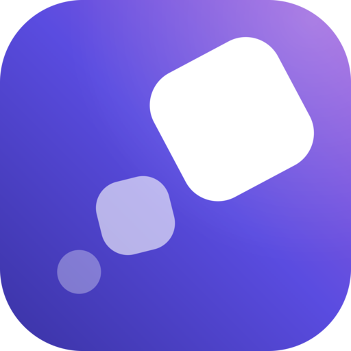
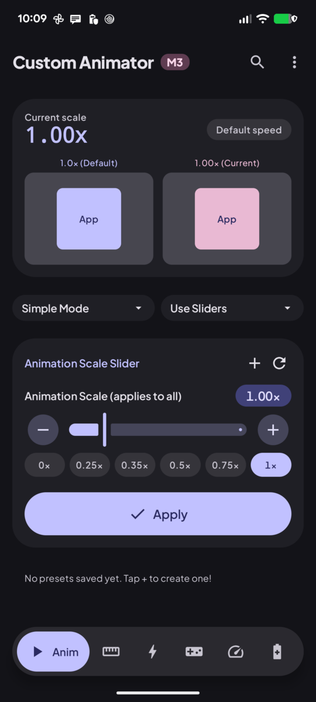
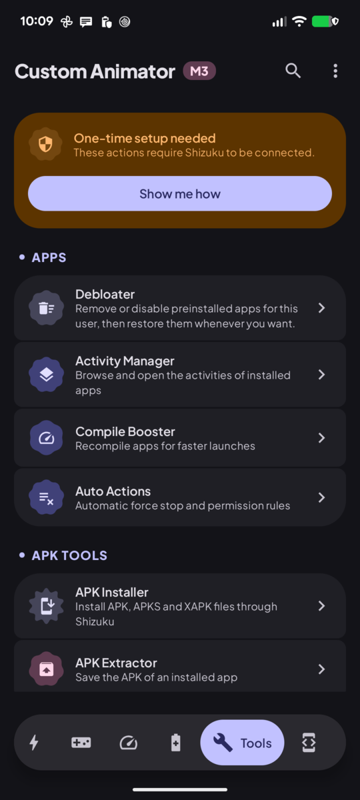
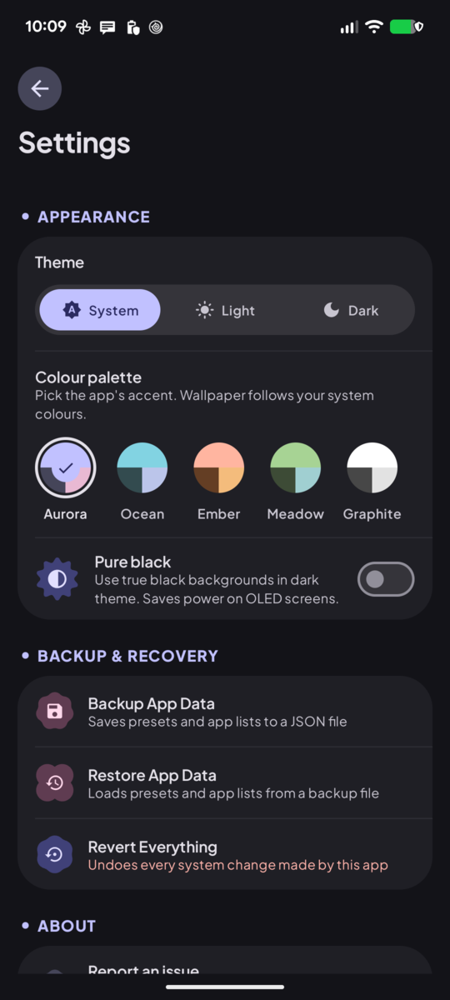
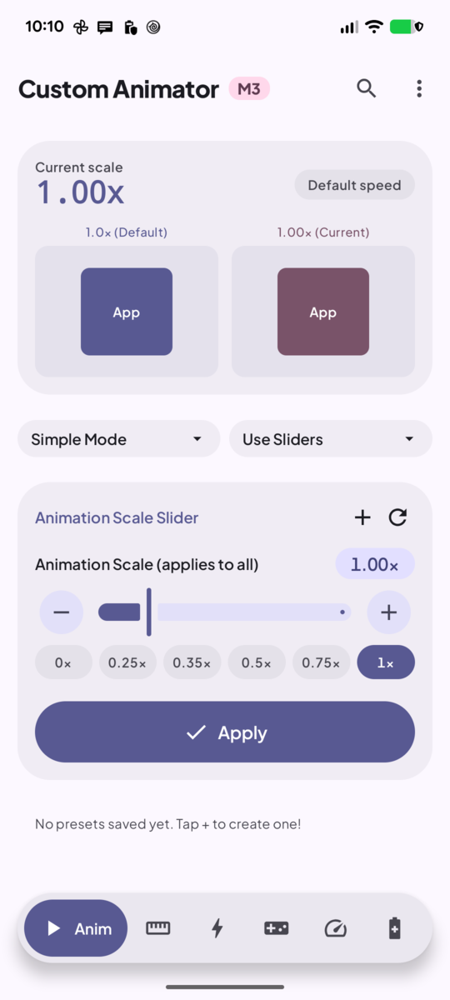

<div align="center">



# Custom Animator M3

**A Material 3 Expressive system tweaker for Android: animation scales, screen density and a toolbox of per-app and system tweaks, all without root.**

[](https://github.com/riyadmondol2006/CustomAnimator-M3/actions/workflows/build.yml)
[](https://github.com/riyadmondol2006/CustomAnimator-M3/releases/latest)
[](LICENSE)


</div>

> [!NOTE]
> **This is a fork.** Custom Animator M3 is based on [**CustomAnimator** by Ahmet Can Arslan](https://github.com/AhmetCanArslan/CustomAnimator), and all credit for the original app and its feature set goes to them. This fork is maintained by [**riyadmondol2006**](https://github.com/riyadmondol2006). It has its own package name (`com.riyadmondol2006.customanimator`), so it installs side by side with the original. Please report problems with this fork [here](https://github.com/riyadmondol2006/CustomAnimator-M3/issues), not upstream.

## Screenshots

<div align="center">
  
  
  
  
</div>

## What's different in M3

| | Upstream | Custom Animator M3 |
|---|---|---|
| **Look** | Wallpaper colours, top tab chips | Own colour identity (Aurora, Ocean, Ember, Meadow, Graphite, or Wallpaper), Plus Jakarta Sans type, a floating bottom dock, new icon |
| **Dark mode** | Standard dark | Standard dark, plus an optional **pure black** mode for OLED |
| **Ads / IAP** | AdMob banners, interstitials, rewarded ads, "Remove ads" purchase | **None.** No ads, no billing, no consent SDK, no `AD_ID` permission |
| **Gated features** | Game Mode, Compile Booster, Optimizer and shortcuts behind a rewarded ad | All unlocked |
| **Distribution** | Google Play | Signed APKs on [GitHub Releases](https://github.com/riyadmondol2006/CustomAnimator-M3/releases), built by CI on every push |
| **Toolchain** | AGP 9.3, Kotlin 2.4.20, Gradle 9.7 | AGP 9.5, Kotlin 2.4.21, Gradle 9.8, NDK 30, Compose BOM 2026.09 |

On top of that, the fork includes a round of stability and compatibility fixes. A few examples:

- The animation scale sliders now stay in sync with the system when scales are changed from a Quick Settings tile, a profile or Developer options. Invalid manual values are rejected instead of being silently ignored.
- Simple mode no longer overwrites your transition and animator values behind your back, and preset names no longer wrap letter by letter.
- Fixes for Android 12–17: foreground-service crashes from the background, a full-screen notification flash that blocked touches, screen wake-up on Android 14+, Quick Settings tiles that could run shell commands from the lock screen, and more.
- Fixed tweaks that reported success but did nothing: Force RTL, Charging sounds, Airplane mode, Limit background processes, the alarm list and memory compaction.

See the [commit history](https://github.com/riyadmondol2006/CustomAnimator-M3/commits/main) for the full list.

## Features

**Animation & display**
- Window, transition and animator duration scales anywhere from **0× (off) to 5×** in 0.01 steps, with sliders, exact input, one-tap picks (0×, 0.25×, 0.35×, 0.5×, 0.75×, 1×), a live speed preview, presets, and Quick Settings tiles per preset
- Screen density / smallest width with presets, automatic revert if you pick something unusable, and per-app width
- Refresh rate control, including per-app refresh rates

**Performance**
- Optimizer: clear app caches, close background apps, with an exclusion list
- Game Mode, which restricts background apps while you play
- Compile Booster: AOT-compile apps with a chosen compiler filter
- Graphics API override, HWUI tweaks, app thread priority, Doze whitelist

**System & tools**
- Debloater (powered by the Universal Android Debloater list), APK extractor and installer, icon changer
- Activity launcher and home-screen shortcuts, custom Quick Settings tiles (toggle, terminal and profile tiles)
- Status bar icon hider, system colours (Monet), button remapper, carrier name, alarm revealer
- Wi-Fi password viewer, hotspot manager, OTP copier, screenshot actions, WhatsApp cleaner
- Profiles that bundle animation, width, battery, developer and shell settings into one tap
- Notification rules: flash, screen flash, wake, AOD and history
- Built-in terminal with command suggestions and presets
- Battery health and battery saver tweaks, plus a live system meter and FPS overlay

## Download

Grab the latest signed `CustomAnimator-M3-*.apk` from **[Releases](https://github.com/riyadmondol2006/CustomAnimator-M3/releases/latest)**. Each release includes a `SHA256SUMS.txt` you can verify against.

Requires Android 7.0 (API 24) or newer. Some tools need a newer Android version and say so in the app.

## Setup

Most tweaks write protected system settings, which needs one of the following:

1. **[Shizuku](https://shizuku.rikka.app/guide/setup/)** (recommended): start it once with wireless debugging (or root), then grant Custom Animator M3 access when asked. This unlocks every feature.
2. **ADB only**: grant the secure-settings permission once from a computer:
   ```sh
   adb shell pm grant com.riyadmondol2006.customanimator android.permission.WRITE_SECURE_SETTINGS
   adb shell pm grant com.riyadmondol2006.customanimator android.permission.SET_ANIMATION_SCALE
   ```
   This is enough for animation scales, density and many developer toggles. Tools that run shell commands still need Shizuku.

The in-app **Setup guide** (Settings → Setup guide) walks you through both options.

## Building from source

Requirements: JDK 21, Android SDK with platform 37. Gradle downloads NDK 30 and CMake 4.1 automatically.

```sh
git clone https://github.com/riyadmondol2006/CustomAnimator-M3.git
cd CustomAnimator-M3
./gradlew assembleDebug          # app/build/outputs/apk/debug/app-debug.apk
./gradlew testDebugUnitTest      # unit tests
```

### Signed release builds

The release build is signed only when signing values are provided, either as environment variables or in `local.properties`:

| Name | Value |
|---|---|
| `SIGNING_KEYSTORE_PATH` | Path to the `.jks` / `.keystore` file |
| `SIGNING_STORE_PASSWORD` | Keystore password |
| `SIGNING_KEY_ALIAS` | Key alias |
| `SIGNING_KEY_PASSWORD` | Key password |

Without them, `./gradlew assembleRelease` produces an unsigned, minified APK.

### Continuous integration

[`.github/workflows/build.yml`](.github/workflows/build.yml) runs on every push and pull request. It builds debug and release APKs, runs the unit tests and uploads the APKs as an artifact. On pushes to `main` it also publishes a GitHub Release with the signed APK. The repository needs these secrets:

`SIGNING_KEYSTORE_BASE64` (the keystore, base64-encoded), `SIGNING_STORE_PASSWORD`, `SIGNING_KEY_ALIAS`, `SIGNING_KEY_PASSWORD`

The version code is `200 + run number`, so every CI build installs over the previous one.

## Privacy

No accounts, analytics, ads or tracking. Presets, rules and logs stay in the app's private storage on your device. See [PRIVACY_POLICY.md](PRIVACY_POLICY.md).

## Credits

- [**Ahmet Can Arslan**](https://github.com/AhmetCanArslan): author of the original [CustomAnimator](https://github.com/AhmetCanArslan/CustomAnimator), which this fork is built on
- [Shizuku](https://github.com/RikkaApps/Shizuku) by RikkaApps
- [Universal Android Debloater](https://github.com/Universal-Debloater-Alliance) package list
- [ClearURLs](https://clearurls.xyz) rules
- [Plus Jakarta Sans](https://github.com/tokotype/PlusJakartaSans) typeface, SIL Open Font License 1.1 ([license](docs/licenses/PlusJakartaSans-OFL.txt))
- [MaterialKolor](https://github.com/jordond/MaterialKolor) colour utilities

## License

GNU General Public License v3.0, the same as upstream. See [LICENSE](LICENSE).

---

> [!WARNING]
> This app changes system-level settings and can force-stop or alter other apps. Use it with care, and try changes on your own device first.
